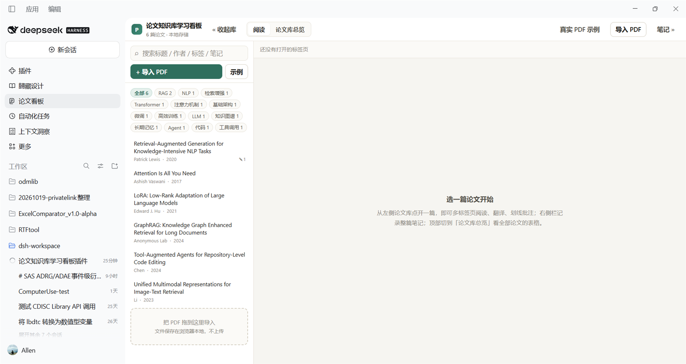
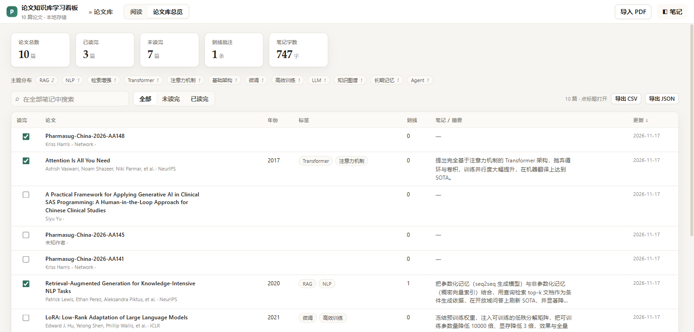
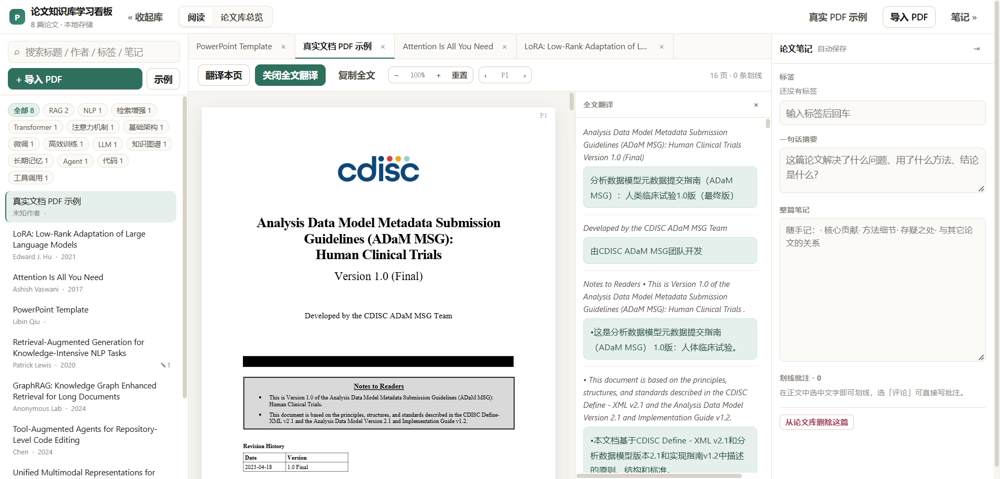
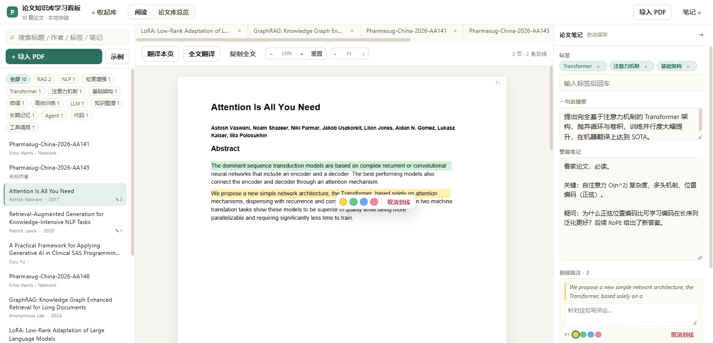
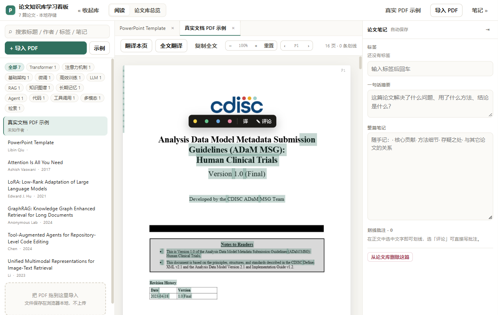
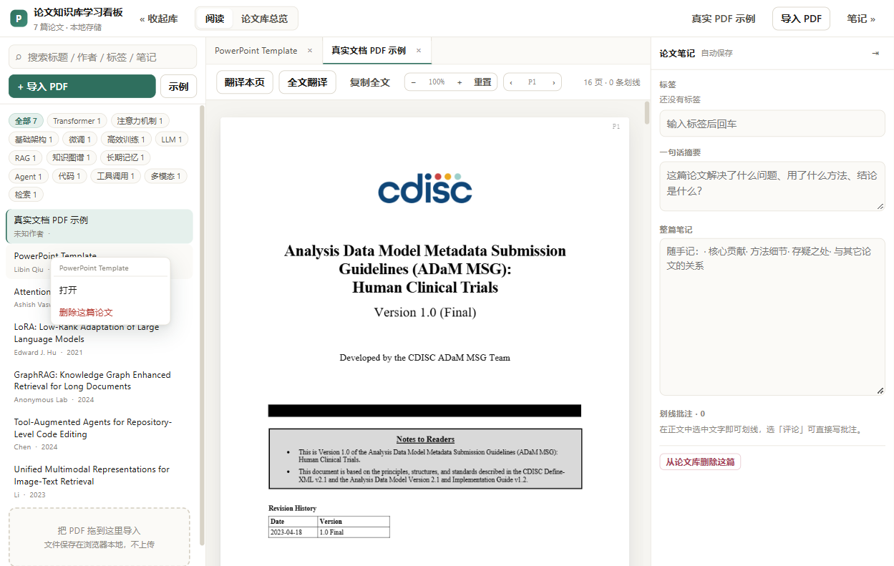
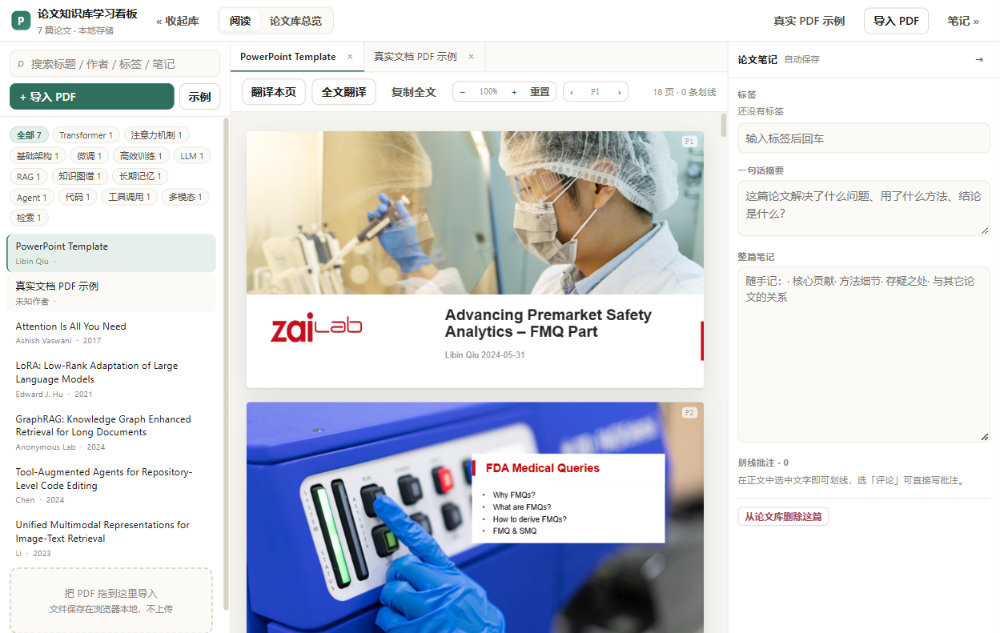
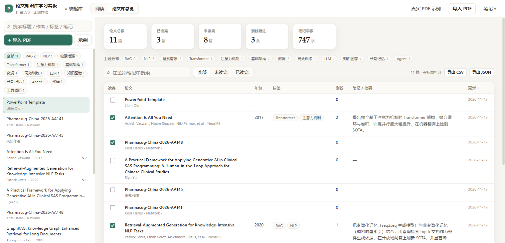

# 论文知识库学习看板 (Paper Board)

一个纯前端的论文学习工作台，对应你的四步工作流：**论文入库 → 多标签精读（翻译/划线/批注）→ 整篇笔记 → 论文库层面复盘**。


## 运行

```bash
node build.mjs        # 打包 src -> dist（Rollup + Babel，进程内构建，不需要 esbuild 子进程）
node serve.cjs        # 静态服务 http://127.0.0.1:5279
```

当前演示服务已在 <http://127.0.0.1:5279> 运行。

> 该环境禁止 spawn 子进程，所以不能用 `vite build`（依赖 esbuild service）。build.mjs 用 Rollup JS API + Babel 在同一个进程内完成编译，产物 `dist/app.js` ≈ 2.15 MB。

## 装进 DeepSeek Harness（侧栏直接打开）

看板已经打成 DSH 插件 `dsh-paper-board`，装在 **desktop** profile 里，启动 DSH 后左侧栏会多一个「论文看板」，点开主区域就是整块看板。



```
dsh-plugin/
  package.json     name=dsh-paper-board，dsh.bundle.patch + dsh.client(platform:web)
  cordis.patch.yml bundle 层：insert 一行 dsh-paper-board
  lib/index.js     宿主半边：ctx.webServer.register({kind:'prefix', path:'/paper-board'})
  lib/client.js    浏览器半边：注册 sidebar.panellist 入口 + main 里 iframe 到 /paper-board/
  web/             dist 的镜像（build.mjs 每次自动同步，勿手改）
```

安装落点：

- junction：`~/.dsh/profiles/desktop/node_modules/dsh-paper-board` → 本目录的 `dsh-plugin`
- `~/.dsh/profiles/desktop/package.json`：dependencies 加 `"dsh-paper-board": "link:../../../file/code/dsh-workspace/article_dashboard_tool/dsh-plugin"`，`dsh.profile.bundles` 末尾加 `dsh-paper-board`
- `~/.dsh/profiles/desktop/cordis.patch.yml`：`- id: dsh-paper-board\n  disabled: false`

改了 `src/` 之后：`node build.mjs`（会自动清空并重写 `dsh-plugin/web`）→ 重新打开「论文看板」标签页即可，不用重启 DSH（宿主静态服务每次请求都读盘、`cache-control: no-store`）。只有改 `dsh-plugin/lib/*.js` 才需要重启 DSH 让宿主半边重新加载。

## 工作流 1｜左侧论文库（可折叠）



- 顶栏「« 收起库」把左侧栏收成窄条，再点一次展开；右侧「笔记 »」同理
- 拖 PDF 到侧栏，或点「+ 导入 PDF」批量入库（只收 PDF，可多选）
- 搜索框按标题 / 作者 / 标签 / 笔记全文过滤
- 标签 chips 多选过滤；「示例」一键载入 6 篇演示论文（RAG、Attention、LoRA、GraphRAG、Agent、多模态）
- 每篇卡片显示标题 / 作者 / 年份 / 划线条数
- **右键论文卡片**弹出菜单：「打开」/「删除这篇论文」；删除会二次确认，笔记、划线、批注一起删掉

## 工作流 2｜多标签阅读器（直接读写原版 PDF）

中间阅读区**不再是抽出来的文字层，而是 pdf.js 把原始 PDF 逐页画成 canvas**，图片、图表、公式、双栏版式、页眉页脚全部按原样呈现；文字层只作为透明覆盖层用于选中。划线、翻译、评论都直接作用在这张"原版纸面"上。

- 点左侧论文即在标签栏新增标签，可同时开多篇，标签带关闭按钮，切换即时
- **滚动**：所有页连续竖排，滚到底自动渲染下一页；工具条左右箭头跳页，右侧显示当前页与「N 页 · M 条划线」
- **缩放**：工具条 `− 100% + 重置` 在 50%–250% 之间缩放；100% 时页面宽度自动铺满阅读区（随窗口尺寸自适应）
- **双屏阅读**：把左侧论文库（「« 收起库」）和右侧笔记栏（「笔记 »」）都收起后，PDF 与译文栏各占一半，像并排两块屏；中间那条竖线可以按住左右拖，随时调 PDF 和译文的宽度比例，双击回到默认 300px，宽度会被记住
- **划线**：在 PDF 上拖选任意文字（跨行、跨段都行，能一直选到行尾最后一个字）→ 紧贴选区上方的浮动条弹出，点四色之一（黄 / 绿 / 蓝 / 粉）即在该处画上半透明色带，位置按页内比例保存，缩放后不跑位；改缩放时浮条与划线菜单会自动收起，不会滞留在旧的坐标上
- **改色 / 取消划线**：点已有色带 → 弹出小菜单，四个色点改色、「取消划线」删除
- **针对某句评论**：选中文字点「✎ 评论」，写批注；批注挂在该处（划线带加深色描边），同时出现在右侧「划线批注」列表，可点击跳回原页
- **单词翻译**：双击任意单词 → 右侧固定「单词」面板显示词义（本地词典优先，缺失时走在线接口），面板底部会标出实际使用的引擎与失败原因
- **整句 / 整段翻译**：选中文字点「译」→ 右侧面板固定显示原文与译文
- **本页翻译 / 全文翻译**：工具条「翻译本页」按段落（按行距自动分段）输出中英对照；「全文翻译」逐页跑完，结果以「原文 / 译文」成对显示在右侧面板，可随时关闭
- **用 AI 翻译**：默认引擎是 DSH 自己的模型——宿主半边通过 `ctx.llm` 调用，用的就是你**在 DSH 设置里当前选中的模型**（`agentDefaultModel`），不另配 key、也不写死模型名，质量比免费接口好一截；AI 不可用时自动退回 Google 免费接口 → 有道 → MyMemory → 本地词典
- **译文只翻一次**：整篇译文连同每段坐标一起存进本机 IndexedDB（库 `paper-board-files`），下次点「全文翻译」立刻整篇展开并标注「已保存 · 时间」；想重来点面板顶部的「重新翻译」
- **点译文回到原处**：点右侧任意一条译文，左边 PDF 自动滚到对应页、对应段落，并在纸面上闪一下高亮，不用自己找



> 翻译靠 PDF 的文字层。扫描版（纯图片）PDF 能正常显示，但选不中文字、也翻译不了。









## 工作流 3｜右侧笔记栏

- 可折叠；内容自动保存
- 标签编辑、一句话摘要、整篇笔记（长文本域，适合边读边记）
- 划线批注列表：每条显示所属页面/句子、可改色、可补评论、可删除、可跳转

## 真实 PDF 示例

顶栏「真实 PDF 示例」会导入两份随包自带的多页 PDF（`fixtures/` 下的 `sample-image.pdf` 18 页含照片与图表、`sample-doc.pdf` 16 页纯文档），用来快速看"原版渲染"效果——图片不会被丢掉。

## 工作流 4｜论文库层面的观察与总结



- 统计卡：论文总数 / 已读完 / 未读完 / 划线批注 / 笔记字数
- **读完勾选由你自己决定**：表格首列 checkbox 直接勾，勾完即计入「已读完」统计（不做任何自动判定）
- 主题分布 chips、全部笔记跨篇搜索、「全部 / 未读完 / 已读完」筛选
- 可排序表格：读完 / 论文（标题+作者+会议）/ 年份 / 标签 / 划线数 / 笔记摘要 / 更新时间（点表头排序，点标题直接打开）
- 导出 CSV（UTF-8 BOM，Excel 直接打开）/ 导出 JSON

## 数据

- 论文元数据、笔记、划线、批注、翻译缓存：`localStorage` 键 `paper-board-state-v2`
- PDF 原始文件：`IndexedDB` 库 `paper-board-files` / store `pdf`
- 全部本地保存，不上传；换浏览器或清站点数据会丢失，可用「导出 JSON」备份

## 目录

```
build.mjs              进程内 Rollup + Babel 打包
serve.cjs              静态服务（dist，端口 5279）
src/
  App.tsx              布局、视图切换、状态编排、CSV/JSON 导出
  types.ts             数据模型
  styles.css           暖白纸感设计系统
  lib/
    store.ts           useBoard() 状态中枢 + localStorage 持久化
    pdfstore.ts        IndexedDB 存 PDF 原文件 + 整篇译文存档（putDocTr/getDocTr）
    pdf.ts             pdf.js 文档缓存 / 逐页渲染 / 段落聚合（带页号与页内坐标）
    demoPdf.ts         为内置示例论文现场生成 PDF（无文件时也能原版渲染）
    translate.ts       AI(宿主 llm) → Google → 有道 → MyMemory → 本地词典（段落批量打包 + 自适应限速 + 限流退避重试）
    colors.ts          四色划线调色板
    seed.ts            6 篇示例论文
  components/
    Sidebar.tsx        左侧论文库（collapsed prop 控制收窄）
    PdfView.tsx        原版 PDF 页面渲染（canvas + 文字层 + 划线色带层）
    Reader.tsx         多标签阅读器（滚动 / 缩放 / 翻译 / 划线 / 批注）
    NotesPanel.tsx     右侧笔记栏
    Library.tsx        论文库总览表格
    ImportDialog.tsx   导入对话框
lib/                  DSH 宿主半边 + 浏览器半边
web/                  前端静态产物（build.mjs 同步）
docs/                  功能截图
```

## 已知限制

- 扫描版 PDF 能原版显示，但没有文字层 → 选不中、划不了线、翻译不出，需先 OCR
- 划线以「页号 + 页内相对矩形」保存，PDF 文件换了（同 id 不同内容）会错位
- 图片型 PDF（整页扫描或用别的工具导出的 PPT）能原样显示图片，但页内文字是画进图里的，选不中 → 划线/翻译用不了；这类页面双击查词会走坐标兜底，可能取不到词
- 极少数情况下 pdf.js 会因为上一轮渲染还没释放 canvas 而拒绝绘制，此时会自动等一拍重绘一次，避免整页空白
- 翻译引擎依次尝试 DSH 的 AI（走宿主 `ctx.llm`，用你设置里选中的模型）→ Google 免费接口 → 有道 → MyMemory → 本地词典。整页/全文翻译会把多段文字**打成一个请求批量提交**（有道单请求约 900 字符封顶，用换行分段、按行切回），一整篇论文通常只需十几次请求而不是上百次；撞上 429/411 会退一大步重试同一批，并自动放慢后续节奏。
- 三个免费引擎都有硬性配额（Google 频繁 429、有道连发几次就 411、MyMemory 每天额度用满要等数小时）。实在全挂时，长段落保留原文并在右侧面板写明原因与重试提示，**不会**再拼成逐词碎片；单段失败不会中断整篇，翻好的部分照常保留、只缓存真实译文，下次点同一按钮会自动续翻没翻的部分。
- 翻译缓存只保留真实译文（AI / 在线引擎），旧的逐词拼接结果会在加载时自动丢弃
- 整篇译文按「论文 id + 页数」匹配存档，PDF 换了或页数变了会自动重翻；想强制刷新点「重新翻译」
- 首次加载约 3.4 MB（app.js 2.1 MB + pdf.js worker 1.3 MB），之后走浏览器缓存
- 插件主区域是 iframe（`/paper-board/`），数据存在浏览器 localStorage / IndexedDB（键 `paper-board-state-v2`），只跟着这台机器的浏览器走，换机器或清站点数据就没了 → 用「导出 JSON」备份
- 侧栏入口与主区域 slot 是 DSH 客户端挂载的，改 `dsh-plugin/lib/client.js` 后需重启 DSH；只改 `web/`（前端）不用重启
