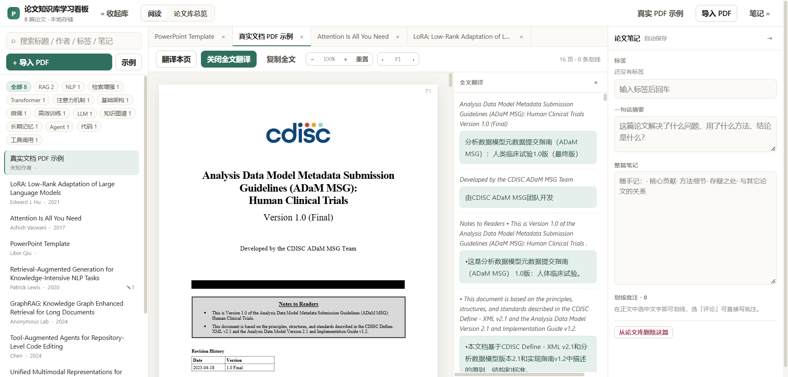
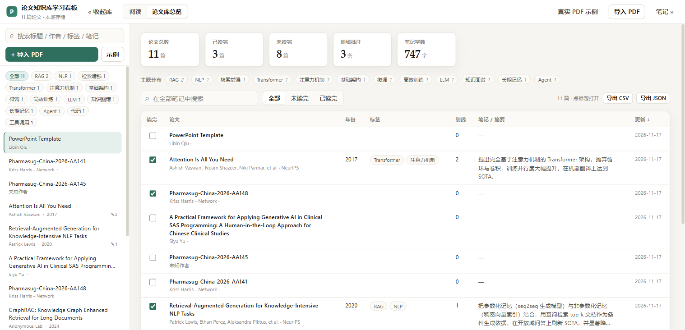
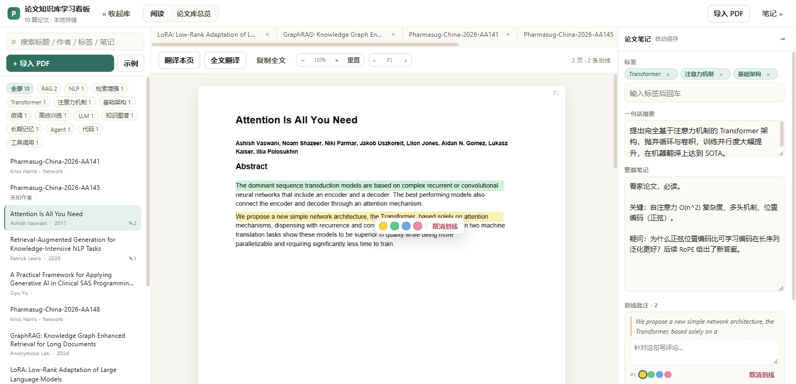
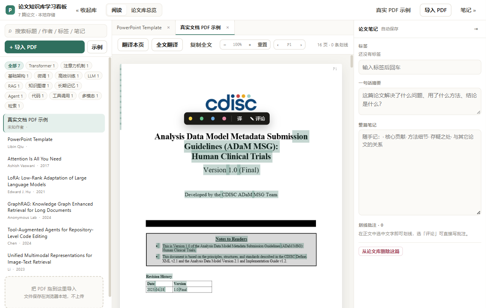

<p align="center">
  
</p>

# paper-reader-hub · 论文知识库学习看板

> 一个装进 [DeepSeek Harness](https://github.com/deepseek-ai) 的论文精读插件：**论文入库 → 多标签精读原版 PDF（AI 翻译 / 划线 / 批注）→ 整篇笔记 → 论文库层面复盘**。
> 全部数据存在你自己的浏览器里，不上传、不联网同步；AI 翻译走你本机 DSH 已经在用的模型，不用另配 key。


<p align="center">
  
  
</p>

---

## 它解决什么问题

读论文时通常要开四五个窗口：PDF 阅读器、翻译网页、笔记软件、文献管理、还有一张记录「读没读完」的表格。这个插件把这几件事压进 DSH 的一个侧栏入口里——PDF 用 pdf.js 原版渲染（图片、公式、双栏版式、页眉页脚都按原样呈现），翻译、划线、批注直接作用在这张「原版纸面」上。

## 功能一览

### 工作流 1｜论文库（左侧，可折叠）

- 拖 PDF 到侧栏，或点「+ 导入 PDF」批量入库（只收 PDF，可多选）
- 搜索框按标题 / 作者 / 标签 / 笔记全文过滤；标签 chips 多选过滤
- 「示例」一键载入 6 篇演示论文（RAG、Attention、LoRA、GraphRAG、Agent、多模态）
- 每篇卡片显示标题 / 作者 / 年份 / 划线条数；**右键卡片**可「打开」或「删除这篇论文」（二次确认，笔记、划线、批注一起删）

### 工作流 2｜多标签阅读器（原版 PDF）

- 点左侧论文即在标签栏新增标签，可同时开多篇，切换即时
- **滚动**：所有页连续竖排，滚到底自动渲染下一页；工具条左右箭头跳页
- **缩放**：`− 100% + 重置`，50%–250%；100% 时页面宽度自动铺满阅读区
- **双屏阅读**：左侧论文库（「« 收起库」）和右侧笔记栏（「笔记 »」）都收起后，PDF 与译文栏并排各占一半；中间那条竖线可按住左右拖，随时调比例，双击回默认 300px，宽度会被记住
- **划线**：在 PDF 上拖选任意文字（跨行、跨段，能一直选到行尾最后一个字）→ 紧贴选区上方的浮动条弹出，点四色之一（黄 / 绿 / 蓝 / 粉）即画上半透明色带，位置按页内比例保存，缩放后不跑位
- **改色 / 取消划线**：点已有色带 → 弹出小菜单，四个色点改色、「取消划线」删除
- **针对某句评论**：选中文字点「✎ 评论」，批注挂在该处并出现在右侧列表，可点击跳回原页
- **单词翻译**：双击任意单词 → 右侧「单词」面板显示词义，底部标出实际使用的引擎
- **整句 / 整段翻译**：选中文字点「译」
- **本页翻译 / 全文翻译**：按段落（按行距自动分段）输出中英对照
- **用 AI 翻译**：默认引擎是 DSH 自己的模型——插件宿主进程通过 `ctx.llm` 调用，模型就是你**在 DSH 设置里当前选中的那个**（`agentDefaultModel`），不另配 key、也不写死模型名；AI 不可用时自动退回 Google → 有道 → MyMemory → 本地词典
- **译文只翻一次**：整篇译文连同每段坐标存进本机 IndexedDB，下次点「全文翻译」立刻整篇展开并标注「已保存 · 时间」；想重来点面板顶部「重新翻译」
- **点译文回到原处**：点右侧任意一条译文，左边 PDF 自动滚到对应页、对应段落并闪一下高亮

<p align="center">
  
  
</p>

### 工作流 3｜右侧笔记栏（可折叠，自动保存）

- 标签编辑、一句话摘要、整篇笔记（长文本域，适合边读边记）
- 划线批注列表：每条显示所属页面 / 句子，可改色、补评论、删除、跳转

### 工作流 4｜论文库总览

- 统计卡：论文总数 / 已读完 / 未读完 / 划线批注 / 笔记字数
- **读完勾选由你自己决定**：表格首列 checkbox 直接勾，勾完即计入统计（不做任何自动判定）
- 主题分布 chips、全部笔记跨篇搜索、「全部 / 未读完 / 已读完」筛选
- 可排序表格；导出 CSV（UTF-8 BOM，Excel 直接打开）/ 导出 JSON

---

## 安装到 DeepSeek Harness

> 需要 DSH 0.2.1 或更新版本（插件机制 + `dsh plugin` 命令）。

### 方式一：命令行安装（推荐）

```sh
# 把 <profile> 换成你的 profile 名：普通 dsh web 是 web，桌面版是 desktop
dsh plugin --profile <profile> add github:allensrj/paper-reader-hub
```

装完重启 DSH。左侧栏会多出一个「**论文看板**」入口，点开主区域就是整块看板。

### 方式二：DSH 桌面版插件市场

1. 打开 **设置 → 插件**（或插件页的 **Plugin Market**）
2. 在安装框里粘贴：`github:allensrj/paper-reader-hub`
3. 安装完成后重启 DSH

### 方式三：本地源码安装（改代码时用）

```sh
git clone https://github.com/allensrj/paper-reader-hub.git
dsh plugin --profile <profile> add link:$PWD/paper-reader-hub
```

### 装完确认

打开看板后，右上角「导入 PDF」旁边能看到「真实 PDF 示例」按钮；点它会把仓库自带的 18 页图文 PDF 和 16 页文档 PDF 导进来，用来确认原版渲染没问题。

AI 翻译是否可用，可以看插件宿主的健康接口（浏览器打开）：

```
http://127.0.0.1:<DSH 端口>/paper-board/api/health
→ {"ok":true,"tag":"1.2.2","hasKey":true,"engine":"host-llm","provider":"...","model":"..."}
```

`hasKey` 为 `true`（兼容旧字段名）表示宿主已经解析到一个可用模型，`provider` / `model` 就是这次要用的那条路由；为 `false` 时 AI 翻译不可用，会自动退回免费引擎。它不再代表「读到了某个 API Key」——模型和凭证都由你已经在用的 DSH 配置提供。

---

## 数据存在哪

| 内容 | 位置 |
| --- | --- |
| 论文元数据、笔记、划线、批注、翻译缓存 | 浏览器 `localStorage`，键 `paper-board-state-v2` |
| PDF 原文件、整篇译文存档 | 浏览器 `IndexedDB`，库 `paper-board-files` |

**全部本地保存，不上传**。换浏览器或清站点数据会丢失 → 用「导出 JSON」备份。

---

## 已知限制

- 扫描版 PDF 能原版显示，但没有文字层 → 选不中、划不了线、翻译不出，需先 OCR
- 划线以「页号 + 页内相对矩形」保存，PDF 文件换了（同 id 不同内容）会错位
- 图片型 PDF（整页扫描、别的工具导出的 PPT）文字画在图里，选不中 → 划线/翻译用不了
- 翻译引擎依次尝试 DSH 的 AI → Google 免费接口 → 有道 → MyMemory → 本地词典；整页/全文翻译把多段文字**打成一个请求批量提交**，撞限流会退一大步重试并自动放慢。三个免费引擎都有硬配额，全挂时长段落保留原文并写明原因，**不会**拼成逐词碎片
- **AI 翻译消耗的是你自己的 DSH 额度**：一次全文翻译会把整篇论文按批发给模型。模型没配好、额度用尽或调用失败时，这一段会退回免费引擎
- 整篇译文按「论文 id + 页数」匹配存档，PDF 换了或页数变了会自动重翻
- 首次加载约 3.4 MB（前端 `app.js` 2.1 MB + pdf.js worker 1.3 MB），之后走浏览器缓存
- 主区域是 iframe。`/paper-board/api/*` 先过宿主自己的准入（`ctx.connection.requestRejection`，Host/Origin 围栏 + 浏览器会话认证），宿主没有该服务时退回内置的同源校验；一次翻译就是一次真实的模型调用，不该由别的网页或未认证的调用方替用户花掉

---

## 从源码构建

```sh
git clone https://github.com/allensrj/paper-reader-hub.git
cd paper-reader-hub
npm install
node build.mjs      # 打包 src -> dist，并同步到 web/（随仓库提交的产物）
node serve.cjs      # 可选：不起 DSH，直接在 http://127.0.0.1:5279 看纯前端版本
```

改完 `src/` 重新 `node build.mjs`，**刷新看板页面即可**，不用重启 DSH（宿主静态服务每次请求都读盘、`cache-control: no-store`）。只有改 `lib/index.js`（宿主半边）或 `lib/client.js`（侧栏入口）才需要重启 DSH。

### 目录

```
package.json        插件清单：dsh.bundle.patch + dsh.client(platform:web)
cordis.patch.yml    bundle 层：insert 一行 dsh-paper-board
lib/index.js        宿主半边：静态路由 /paper-board + /paper-board/api/{translate,health}
lib/client.js       浏览器半边：注册 sidebar.panellist 入口 + main 里 iframe 到 /paper-board/
locale/             插件标题与描述（DSH「设置 → 插件」里显示）
screenshots.json    插件市场卡片截图顺序
web/                构建产物（build.mjs 生成，随仓库提交，装插件时不用自己构建）
build.mjs           进程内 Rollup + Babel 打包
serve.cjs           纯前端静态服务（端口 5279，不依赖 DSH）
src/                React + TypeScript 源码
fixtures/           示例 PDF
docs/               功能截图
```

### src 结构

```
src/
  App.tsx            布局、视图切换、状态编排、CSV/JSON 导出
  types.ts           数据模型
  styles.css         暖白纸感设计系统
  lib/
    store.ts         useBoard() 状态中枢 + localStorage 持久化
    pdfstore.ts      IndexedDB 存 PDF 原文件 + 整篇译文存档（putDocTr/getDocTr）
    pdf.ts           pdf.js 文档缓存 / 逐页渲染 / 段落聚合（带页号与页内坐标）
    demoPdf.ts       为内置示例论文现场生成 PDF
    translate.ts     AI → Google → 有道 → MyMemory → 本地词典（批量打包 + 自适应限速）
    colors.ts        四色划线调色板
    seed.ts          6 篇示例论文
  components/
    Sidebar.tsx      左侧论文库
    PdfView.tsx      原版 PDF 页面渲染（canvas + 文字层 + 划线色带层）
    Reader.tsx       多标签阅读器（滚动 / 缩放 / 翻译 / 划线 / 批注 / 分栏拖动）
    NotesPanel.tsx   右侧笔记栏
    Library.tsx      论文库总览表格
    ImportDialog.tsx 导入对话框
```

---

## English

A paper-reading hub plugin for DeepSeek Harness. Import PDFs, read them in their original layout (pdf.js canvas), translate a page or the whole document with the model your DSH already runs, highlight and comment directly on the page, keep per-paper notes, and review everything in a sortable library table. All data stays in your own browser (localStorage + IndexedDB).

Translation calls the host's `ctx.llm` with the provider and model selected in your DSH settings, so it spends your own tokens; when no model is available the plugin falls back to free engines (Google → Youdao → MyMemory → local dictionary). Its HTTP routes accept same-origin requests only.

```sh
dsh plugin --profile <profile> add github:allensrj/paper-reader-hub
```

Restart DSH, then open the **论文看板 / Paper Board** entry in the sidebar.

## License

MIT
